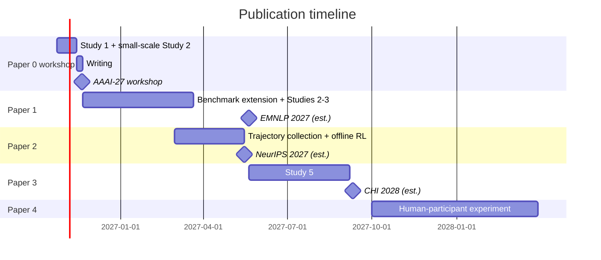

# Publication Plan: Role-Aware Help-Seeking in Multi-User LLM Agent Systems

> Created 2026-10-23. Deadlines marked [confirmed] were checked on the official site. Deadlines marked [estimated] are inferred from past years; confirm them before submitting.
> The corresponding proposal is `01_PhD_Research_Proposal_RoleAwareHelpSeeking_*.docx`.

## 1. Overview: 4 papers, plus 1 workshop paper first

| # | Paper | RQ / Study | Type | First-choice venue | Alternatives | Deadline |
|---|---|---|---|---|---|---|
| 0 | Short paper: problem definition + preliminary evidence | Reduced RQ1 + RQ2 | Workshop (4–6 pages) | AAAI-27 Human-AI Collaboration workshop, 2026-11-20 [confirmed](https://human-ai-workshop-7p350s.webnode.page/) | CHI 2027 workshops (calls around mid-December, deadlines about Feb 2027 [estimated]); ICLR 2027 workshops (about Feb 2027 [estimated]) | 4 weeks away |
| 1 | Characterizing role-aware help-seeking (diagnosis + benchmark + LLM comparison) | RQ1–RQ3, Studies 1–3 | Long paper | ACL 2027, ARR deadline 2027-01-04 [confirmed](https://2027.aclweb.org/calls/main/) | EMNLP 2027 (ARR cycle around May 2027 [estimated]); NeurIPS 2027 D&B (May–June 2027 [estimated]) | ACL is tight; EMNLP 2027 is more realistic |
| 2 | Learning when and whom to ask (trained policy model) | RQ4, Study 4 | Long paper (method) | NeurIPS 2027 main track (May 2027 [estimated]) | ICLR 2028 (Sep–Oct 2027 [estimated]); ACL/EMNLP 2028 | Mid-2027 |
| 3 | Team structure and help-seeking (team structure as a moderator) | RQ5, Study 5 | Long paper (HCI / human factors) | CHI 2028 (about Sep 2027 [estimated]; CHI 2027 closed 2026-09-10 [confirmed](https://chi2027.acm.org/authors/papers/)) | CSCW (several deadlines per year); HFES 2027 Annual Meeting | Fall 2027 |
| 4 (optional) | Human-participant validation (people play colleagues, or judge whether the agent asked the right person) | Validates key findings of Papers 1–3 | Long paper (HCI) | CHI 2029 / CSCW | IUI, CHIWORK | 2028 |

## 2. Timeline

| Period | Work | Milestone |
|---|---|---|
| 2026-10-24 → 11-13 | Study 1 trajectory annotation; small-scale Study 2 (about 30–50 tasks, 3 models) | — |
| 11-14 → 11-20 | Write the 4–6 page workshop paper; post to arXiv at the same time | **Paper 0 submitted (11-20)** |
| 2026-11-21 → 2027-03 | Extend the benchmark (distractors, more organizations); full Studies 2–3; 5+ models; manual annotation | If on track, submit to ACL 2027 (1-04); otherwise move to EMNLP |
| 2027-03 → 05 | Collect trajectories with randomized assignment; offline RL training (in parallel with Paper 1) | **Paper 1 → EMNLP 2027; Paper 2 → NeurIPS 2027** |
| 2027-05 → 09 | Study 5: team structure as a moderator | **Paper 3 → CHI 2028** |
| 2027-10 → 2028 | Human-participant experiment (needs ethics review) | Paper 4 → CHI 2029 / CSCW |

## 3. Notes
1. **Paper 0 is a placeholder.** If the workshop is non-archival, the same content can later be expanded into Paper 1 without counting as duplicate submission. Check the archival policy in the AAAI-27 workshop CFP.
2. **ACL 2027 (1-04) is high-risk for Paper 1.** It leaves about 10 weeks, which is not enough to scale up tasks and models and do manual annotation. Switch to EMNLP 2027 if needed.
3. **Papers 1 and 2 can run in parallel.** The randomized-assignment trajectories Paper 2 needs can be collected together with Paper 1's experiments.
4. **Paper 3 depends on Paper 1's benchmark.** It is HCI / human factors work and suits HCI-oriented supervisors as co-authors (for example, Kuzminykh or Burns).
5. **Paper 4 needs ethics review (REB)** and must be affiliated with a university, so it is best done after enrolling or after a supervisor is confirmed.
6. **Minimum viable combination:** Papers 0 + 1 + 2 already form the main line of a PhD thesis.
7. **Do not put specific deadlines in the proposal.** The plan "Paper 1–4 + corresponding RQs" is enough there. This file is for project management only.

## 4. Google Scholar indexing and citation for workshop papers

Whether Google Scholar indexes a paper depends mainly on **whether the paper is posted on a public academic site**, not on whether it is a workshop paper.

| Where the paper is posted | Indexed? | Notes |
|---|---|---|
| arXiv preprint | **Yes**, usually within a few days to two weeks | Safest option; Google Scholar crawls arXiv quickly |
| OpenReview (many ICLR/NeurIPS workshops) | Usually yes, once the accepted PDF is public | Some workshops do not make rejected submissions public |
| ACL Anthology (ACL/EMNLP-family workshops) | **Yes** | These usually have formal proceedings |
| AAAI workshops | Not guaranteed | Most are non-archival and only hosted on the workshop website |
| CHI workshop position papers | Not guaranteed | Usually only on the workshop website, not in the ACM DL |
| Submitted only, no public PDF | **No** | Others cannot find it or cite it |

**Citation:** once a paper is public (especially on arXiv), others can cite it and Google Scholar counts the citations. Workshop papers are usually cited less on average than main-conference papers. Even so, an arXiv timestamp can **establish priority** for a problem formulation, and problem-definition papers are often cited as the "first to propose" work.

**Recommended practice**
1. When you submit to a workshop, **also post the paper to arXiv**.
2. **Check whether the workshop is non-archival.** If it is, an expanded version can later go to a main conference. If it is archival, the main conference usually requires substantial new content. See the target venue's dual-submission policy (for the ACL family, the ARR CFP).
3. Add the paper to your Google Scholar profile and include the link when emailing supervisors.
4. **Before posting to arXiv under a Microsoft affiliation, confirm the company's external publication approval process.**
